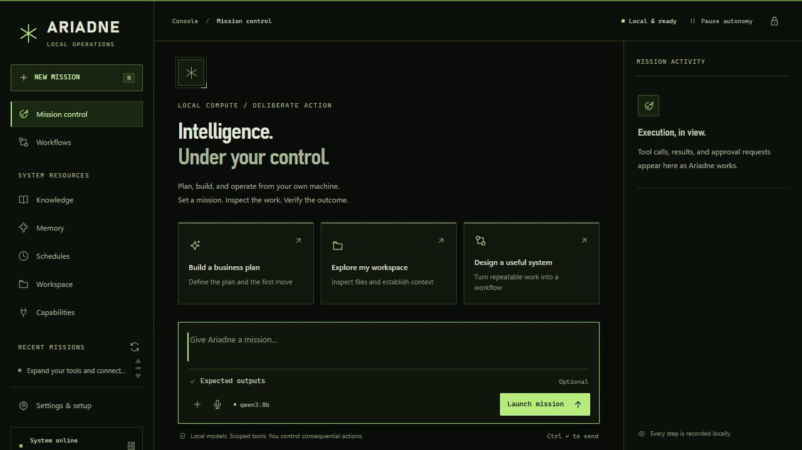

# Field-console interface, Ariadne 0.2.1

Delivered 2026-10-28. The visual brief was "matrix meets the modern military brooding dark GWOT", with a precise, clean presentation.

The interface uses near-black and olive surfaces, restrained phosphor accents, condensed headings, monospaced operational labels, fine grid/edge details and square controls. All fonts/assets remain local; no decorative telemetry, network dependency or new UI package was added. Success, warning and failure retain explicit text and separate visual states. Reduced-motion rules, focus outlines, a scrollable short-screen sidebar and a bounded scrollable composer keep controls reachable.

Validation:

- All 122 existing DOM IDs and 116 data/ARIA hooks were preserved. No duplicate IDs or missing hook targets were introduced.
- JavaScript syntax passed. Its only changes are two display-copy strings; request handling, approval logic, state and event behavior are unchanged.
- Primary foreground/background contrast measured 12.34:1. Danger hover was darkened after review to meet the small-text threshold. These selected checks are not a claim of a complete accessibility certification.
- Desktop browser inspection covered mission control, capability cards, pairing and synthetic approval controls. Approval fixtures stayed paused and were never executed. Responsive CSS was reviewed, including small-screen reachability; a physical mobile-device test was not performed.
- The verified idle Yikes listener was stopped, a private backup created at `backups/ariadne-before-field-console-20261028.zip`, and the updated server restarted. `/health` reported 0.2.1. Pairing, historical mission state and the persisted Qwen3:8b choice were retained. The deployed console was successfully paired and visually checked. The disposable port 8089 preview was stopped afterward.

The source/runtime functionality remains the reviewed 0.2 implementation; the prior full 90-test result is recorded in VERIFICATION_0_2.md. This cosmetic iteration used focused static/visual checks instead of rerunning inference or the unchanged backend suite.

During the subsequent requested repository research, the current Python certificate advisory was verified with the Python security team. Only Yikes' `.venv` pip was updated from 26.2.1 to 26.2.2 using a hash-locked requirement and a retained offline wheel. No machine-wide interpreter/OS change was made, and no researched capability repository was installed or activated. Online integration still requires qualifying the actual runtime/OS trust stores as described in README.md.

